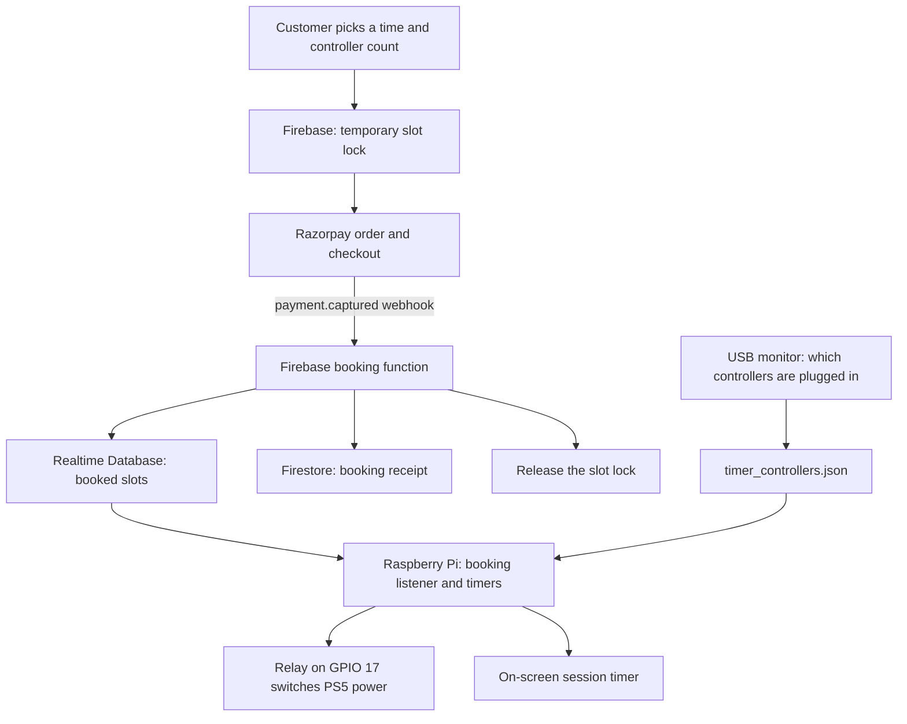

# Kaboom café

Kaboom was our automated gaming café. A Raspberry Pi at the PS5 station listened for bookings in Firebase, switched the console's power with a relay, showed the session timer on screen, and at the end prompted customers to put the controllers back on their charging cables. The location has since closed.

This repo has the Firebase backend (Razorpay payments, slot locks, bookings), the Raspberry Pi station scripts, and an older web booking client. The customer mobile app is in [kaboomMvp](https://github.com/bigtopro/kaboomMvp). That app was a prototype and never went live.

## How it works

## The hardware: from RFID to USB

The station had to know which controllers were back on their chargers. Our first hardware module used RFID: we opened up third-party controller chargers and fitted RFID inside them. The RFID polling gave us trouble at first. We fixed that, but once the module was installed at the café it still wasn't reliable.

So we replaced it with plain USB. The controllers' charging cables plug into the Pi, which watches USB connect and disconnect events, recognises a DualSense controller by its USB vendor and product IDs, and tells controllers apart by the port each cable is plugged into. That code is in [list_dualsense_controllers.py](list_dualsense_controllers.py) and [get_devicepaths.py](get_devicepaths.py). The station folder is still called `my_rfid_project` from the first version.

The `control_bulb` file names are also left over. The scripts switch the PS5's power through a solid-state relay on GPIO pin 17, in a function called `control_ps5`.

## Station script versions

We kept each version of the station script as we changed it:

| File | What changed |
| --- | --- |
| [control_bulb2(original).py](control_bulb2%28original%29.py) | First version: booking timers, relay control, and a countdown prompting customers to return the controllers. |
| [control_bulb2(restart).py](control_bulb2%28restart%29.py) | Fixes the session countdown, which had counted down from the warning delay instead of the time left. Adds log files and Telegram alerts. |
| [control_bulb2(restartnew).py](control_bulb2%28restartnew%29.py) | Reboots the Pi between bookings, at most once every three hours, and keeps the last reboot time on disk. |
| [control_bulb2 (3).py](control_bulb2%20%283%29.py) | Latest copy. Reads bookings per café and per game type and runs the display fullscreen. It has no reboot logic, and its controller check is switched off (`REQUIRED_CONTROLLERS = 0`). |
| [control_bulb(new original).py](control_bulb%28new%20original%29.py) | A side variant with timer and notification changes and an unfinished timer edit. |

## Where to look

| File or folder | What it shows |
| --- | --- |
| [functions/index.js](functions/index.js) | Razorpay orders and webhook, booking writes, slot locks, discounts, and account deletion. |
| [control_bulb2 (3).py](control_bulb2%20%283%29.py) | The station: booking listener, relay control, and session display. |
| [list_dualsense_controllers.py](list_dualsense_controllers.py) | USB controller detection. |
| [custom_code/actions/](custom_code/actions/) | The app's FlutterFlow actions for slot locking, order creation, and Razorpay checkout. |
| [public/src/booking.js](public/src/booking.js) | The older web booking client: slot selection, pricing, checkout, and an admin path that books without payment. |

## Cloud Functions

All of these are in [functions/index.js](functions/index.js).

| Function | What it does |
| --- | --- |
| `createOrder` | Creates a Razorpay order, converting the amount to paise and putting the booking details in the order notes. |
| `razorpayWebhook1` | Checks the webhook's HMAC signature. On `payment.captured` it books the slots; on `payment.failed` it releases the locks. |
| `handleCallbackBooking` | Writes the booked slots to Realtime Database, releases the locks, and saves a receipt in Firestore. |
| `lockSlotsTemporarily` / `releaseLockedSlots` | Hold slots for three minutes during checkout, then release them. |
| `getDiscountAmount` | Works out the `happyhour`, `every5th`, and `newuser` offers. |
| `checkPhoneExists` | Checks whether a phone number already has an account. |
| `AccountDeletion` / `cancelAccountDelete` | Schedule an account's deletion, or cancel it. |

Locks live at `public/locks/{cafeId}/{gameType}/{slotId}`, bookings at `public/slots/{cafeId}/{gameType}/{slotId}`, and receipts in Firestore at `transactions/{userId}/dashboardDetails/{receiptId}`.

## Team

We built Kaboom as a team: Venu ([@bigtopro](https://github.com/bigtopro), older commits as `BarneyStinson4956`), [@sai-suneeth](https://github.com/sai-suneeth), and [@Adithyakumar13](https://github.com/Adithyakumar13).

This public repo is a clean snapshot with credentials removed. The full history is in our private repositories: the station scripts were first committed on 25 October 2024 and the latest copy on 25 August 2025.

## Running it

This is an archive of the café's software, not a ready-to-run demo. To restore it:

- **Backend:** Node.js 18. Run `npm ci` in `functions/`. It reads `RAZORPAY_KEY_ID`, `RAZORPAY_KEY_SECRET`, and `RAZORPAY_WEBHOOK_SECRET` from `.env.main`, which is not included.
- **Firebase:** point `.firebaserc`, `functions/index.js`, the clients, and the Python listener at the same project. Database rules are not included.
- **Payments:** send Razorpay's payment events to the deployed `razorpayWebhook1` endpoint, with the same webhook secret.
- **Station:** a Raspberry Pi with a desktop session (for Tkinter), Firebase credentials, `pyudev`, and `pyinotify`. Paths are hardcoded under `/home/kaboom-gaming/my_rfid_project/`.

Use separate Firebase and Razorpay test projects. The scripts write bookings, send notifications, switch the relay, and in `restartnew`, reboot the Pi.
